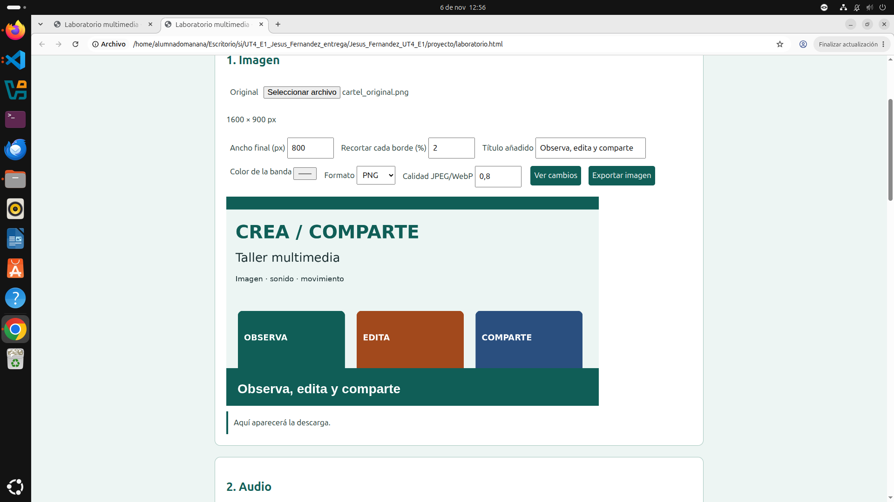
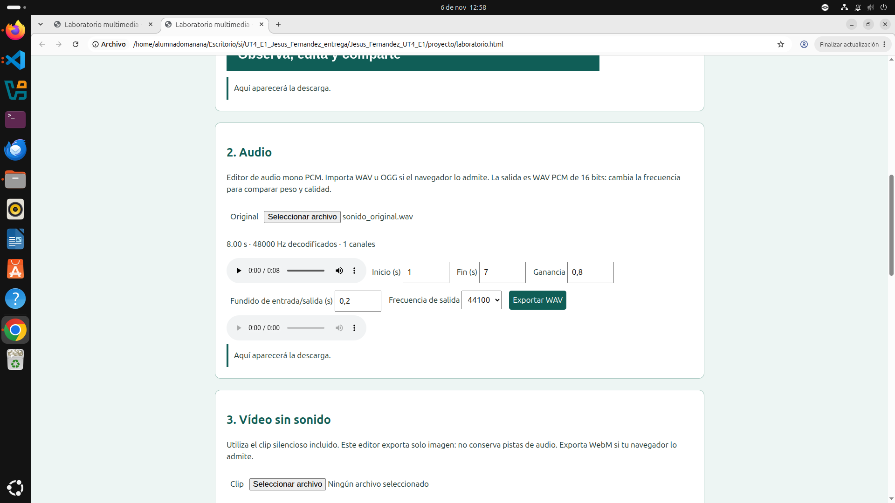
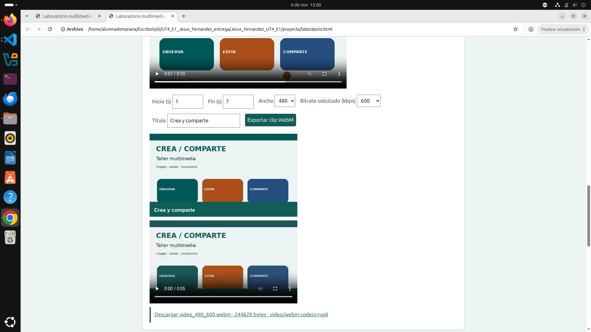
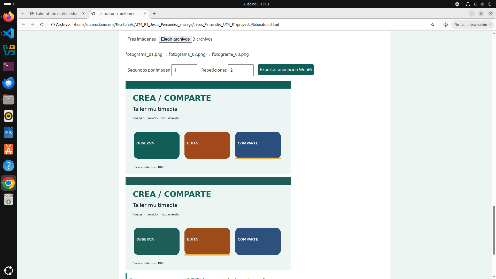

# Capturas reales que debes añadir antes de entregar

El enunciado pide cuatro capturas de la herramienta funcionando. No se han incluido capturas simuladas. Hazlas en Firefox o Chromium en tu ordenador y guárdalas **directamente en esta carpeta `evidencias/`**, con estos nombres exactos:

1. **`captura_01_imagen.png`**: 
 

ancho **800**  
recorte **2 %**  
título **Observa, edita y comparte**  
color **#075e56**  

 

2. **`captura_02_audio.png`**:
 

inicio **1**  
fin **7**  
ganancia **0,8**  
fundido **0,2**  
frecuencia **44100 Hz**  

 

3. **`captura_03_video.png`**: 
 

inicio **1**  
fin **7**  
ancho **480**  
bitrate **600 kbps**  
título común  

 

4. **`captura_04_animacion.png`**:  
 

**1 segundo** por imagen  
**2 repeticiones**  

